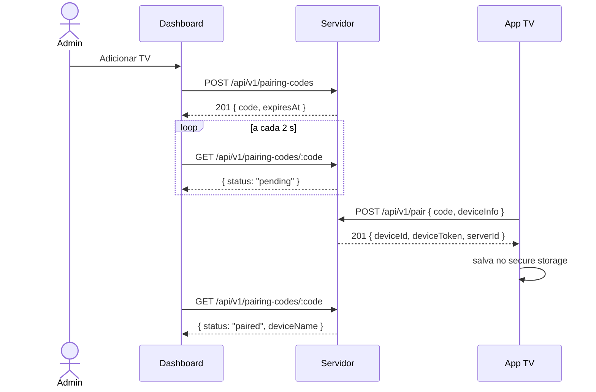

# Protocolo do Beyond TV

Especificação das mensagens entre o servidor, o dashboard e as TVs. O resumo
fica na [seção 7 do plano](PLANO_DE_DESENVOLVIMENTO.md#7-protocolo-de-comunicação);
este documento traz os detalhes do que já está implementado. Os modelos em
Dart ficam no pacote [`beyond_protocol`](../packages/beyond_protocol).

Os exemplos usam `192.168.0.10` como IP do PC do servidor.

## Convenções

- API REST com prefixo `/api/v1`, corpo e respostas em JSON (UTF-8).
- Datas em ISO 8601 UTC (`2026-10-14T12:10:00.000Z`).
- Corpo de requisição limitado a 64 KiB (`413` acima disso).
- Erros sempre no formato abaixo. O `code` é estável e serve para o cliente
  decidir o que fazer; a `message` está em português e pode ser exibida.

  ```json
  { "error": { "code": "invalid_code", "message": "Código inválido. ..." } }
  ```

| Status | `code` | Quando |
|--------|--------|--------|
| 400 | `bad_request` | JSON inválido ou campo ausente. |
| 401 | `unauthorized` | Rota de admin sem sessão válida. |
| 403 | `forbidden_origin` | Método que altera dados vindo de outra origem (CSRF). |
| 404 | `not_found` | Rota ou recurso inexistente. |
| 413 | `payload_too_large` | Corpo acima de 64 KiB. |
| 429 | `too_many_requests` | Rate limit; o cabeçalho `Retry-After` diz quantos segundos esperar. |
| 500 | `internal_error` | Erro inesperado (detalhes só no log do servidor). |

## Autenticação do administrador

O dashboard usa um cookie de sessão:

```
Set-Cookie: beyond_session=<token>; Path=/; HttpOnly; SameSite=Strict; Max-Age=604800
```

- O token tem 32 bytes aleatórios; o banco guarda só o SHA-256.
- A sessão vale 7 dias a partir do login.
- `POST`, `PUT`, `PATCH` e `DELETE` com cabeçalho `Origin` diferente do
  servidor recebem `403`. Clientes sem `Origin` (o app da TV) passam.

| Método | Rota | Auth | Corpo | Resposta |
|--------|------|------|-------|----------|
| GET | `/setup/status` | — | — | `200 { "configured": false }` |
| POST | `/setup` | — | `{ "username", "password" }` | `201 { "username" }` + cookie. `409 already_configured` se já houver admin. |
| POST | `/auth/login` | — | `{ "username", "password" }` | `200 { "username" }` + cookie. `401 invalid_login`. |
| POST | `/auth/logout` | cookie | — | `204` e apaga o cookie. |
| GET | `/auth/session` | cookie | — | `200 { "username" }` ou `401`. |

Regras:

- Usuário com 3 a 32 caracteres (`A-Z a-z 0-9 . _ -`); senha com 8
  caracteres a 72 bytes (`400 invalid_credentials`).
- Cada IP pode errar o login 5 vezes por minuto (`429`). Um login certo zera
  o contador.

## Descoberta (UDP)

A TV procura servidores na rede local por broadcast UDP
([ADR 0004](adr/0004-descoberta-udp.md)).

1. A TV envia o texto `BEYONDTV_DISCOVER v1` para `255.255.255.255:8788` e
   para o broadcast de cada rede dela (ex.: `192.168.0.255:8788`), duas
   vezes, e espera 3 segundos.
2. O servidor responde em unicast para a origem do pacote:

   ```json
   { "v": 1, "name": "PC-SALA", "port": 8787, "serverId": "3f2a…" }
   ```

3. O IP do servidor é o **endereço de origem** da resposta, não vai no JSON.
   A TV ignora respostas com outra versão (`v`) e repetidas (`serverId`).

Pacotes diferentes de `BEYONDTV_DISCOVER v1` são ignorados. A porta muda com
`--discovery-port` / `BEYOND_DISCOVERY_PORT`. Se a descoberta falhar (rede
com isolamento de clientes, broadcast bloqueado, emulador), a TV oferece
**Digitar IP**: ela confere o endereço em `GET /health` antes de seguir.

## Pareamento



### Código de pareamento

- 6 caracteres do alfabeto `23456789ABCDEFGHJKMNPQRSTUVWXYZ` (sem 0/O e
  1/I/L), gerados com `Random.secure`.
- Vale 10 minutos e uma única vez. Fica só na memória do servidor; reiniciar
  o servidor invalida os códigos pendentes.
- Depois de vencer, continua consultável por mais 10 minutos (para o
  dashboard mostrar "expirado" ou "pareado") e então é esquecido.
- A TV pode mandar o código em minúsculas ou com hífen/espaços; o servidor
  normaliza.

### Rotas

| Método | Rota | Auth | Resposta |
|--------|------|------|----------|
| POST | `/pairing-codes` | admin | `201 { "code": "K7M4QX", "expiresAt": "…" }` |
| GET | `/pairing-codes/:code` | admin | `200 { "code", "expiresAt", "status", "deviceId"?, "deviceName"? }` ou `404` |
| POST | `/pair` | — | `201 { "deviceId", "deviceToken", "serverId" }` |

`status` é `pending`, `paired` ou `expired`. `deviceId` e `deviceName`
aparecem depois do pareamento.

### `POST /api/v1/pair`

```json
{
  "code": "K7M4QX",
  "deviceInfo": {
    "appVersion": "0.1.0",
    "manufacturer": "Acme",
    "model": "TV 4K",
    "androidVersion": "11",
    "screenWidth": 1920,
    "screenHeight": 1080
  }
}
```

Só `appVersion` é obrigatório em `deviceInfo`. A TV entra com o nome
sugerido a partir de fabricante e modelo (`Acme TV 4K`), ou `Nova TV`.

| Status | `code` | Mensagem na TV |
|--------|--------|----------------|
| 201 | — | Pareada. |
| 400 | `invalid_code` | Código inválido (não existe, já foi usado ou formato errado). |
| 400 | `expired_code` | Código expirado. Gere um novo no painel. |
| 400 | `bad_request` | Pedido malformado (ex.: sem `deviceInfo`). |
| 429 | `too_many_requests` | Mais de 5 tentativas por minuto deste IP. |
| — | — | Servidor inacessível (sem resposta em 8 s). |

### Credenciais da TV

- `deviceToken`: 32 bytes aleatórios em base64url. Aparece **só** nesta
  resposta; o servidor guarda apenas o SHA-256 e não consegue recuperá-lo.
- A TV salva `deviceId`, `deviceToken` e o servidor (`host`, `port`, `name`,
  `serverId`) no `flutter_secure_storage` (Android Keystore).
- O `serverId` identifica o servidor: a TV não usa o token com um servidor
  de `serverId` diferente.
- A conexão em tempo real com o token (`WS /ws/device`) chega na fase 5.

## Saúde

`GET /health` (sem auth) responde
`{ "status": "ok", "version": "0.1.0", "protocol": 1 }`.
